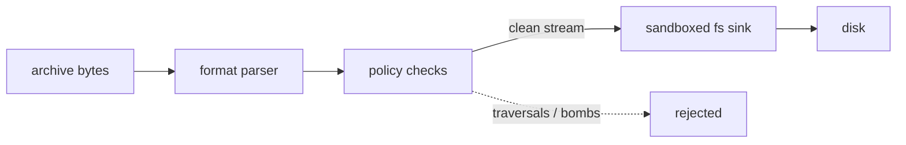

<div align="center">

# oxar

### fast archives and safe codecs for python, written in rust

[](https://github.com/programmersd21/oxar/actions/workflows/ci.yml)
[](https://github.com/programmersd21/oxar/actions/workflows/wheels.yml)
[](https://python.org)
[]-c35832?style=flat-square&logo=rust&logoColor=ffffff)](https://www.rust-lang.org)
[](LICENSE-MIT)

**pure safe rust core (`#![forbid(unsafe_code)]`) with zero-overhead python bindings.**

[quick start](#quick-start) • [speed](#speed) • [safety](#safety) • [cli](#cli) • [docs](docs/api.md)

</div>

---

## why we built this

working with archives in python usually means juggling `zipfile`, `tarfile`, and external compression libraries with conflicting apis, gil bottlenecks, and risky defaults (like zip-slip or unpack bombs).

oxar gives you one clean tool for everything:
* **100% safe rust**: compiled under `#![forbid(unsafe_code)]`. no raw pointers, memory leaks, or unchecked c extensions.
* **secure by default**: path traversal attacks, symlink loops, and overlapping entry bombs are rejected automatically.
* **fast**: releases the python gil for heavy workloads. up to 6.6x faster than standard library modules.

---

## speed

measured against python stdlib on linux x86_64 across 22 paired runs:

| operation | oxar | stdlib | result |
| :--- | :--- | :--- | :--- |
| **tar.gz read single file** | **5.2 ms** | 34.6 ms | **6.6x faster** |
| **tar.gz extract all** | **9.3 ms** | 27.2 ms | **2.9x faster** |
| **tar.gz list** | **4.4 ms** | 10.5 ms | **2.4x faster** |
| **zip read single file** | **1.3 ms** | 2.4 ms | **1.8x faster** |
| **zip extract all** | **7.8 ms** | 8.9 ms | **1.14x faster** |
| **zstd compression** | **fast** | unsupported | **full support** |
| **bzip2 compression** | **faster** | baseline | **oxar wins** |

full benchmarks and reproduction steps are in [docs/benchmarks.md](docs/benchmarks.md).

---

## quick start

```bash
pip install oxar
```

### inspect and extract archives

```python
import oxar

# list files without unzipping everything
for entry in oxar.list("archive.tar.gz"):
    print(entry.kind.value, entry.size, entry.path)

# grab one file directly
with oxar.open("backup.zip") as arc:
    data = arc.read("config.json", max_size=10 * 1024 * 1024)

# safely extract to a directory (with size caps and path sandboxing)
report = oxar.extract("archive.tar.gz", "output/")
print(f"extracted {report.entries} files ({report.bytes_written} bytes)")
```

### one-shot codecs

```python
import oxar

compressed = oxar.compress(b"hello world", codec="zstd", level=3)
raw = oxar.decompress(compressed, codec="zstd")
```

supported codecs: `zstd`, `gzip`, `bzip2`, `xz`, `lzma`, `lz4`, `brotli`, `snappy`, `zlib`, `deflate`.

---

## how extraction works



format readers never write directly to disk. every path is sanitized and verified inside a capability-isolated sink before anything touches your filesystem.

---

## cli

oxar includes a fast command line tool:

```bash
# list contents
oxar list backup.zip

# extract safely
oxar extract backup.tar.gz restored/

# create archives
oxar create bundle.zip src/
oxar create bundle.tar src/ --format tar

# test integrity or detect formats
oxar test backup.zip --json
oxar detect unknown.bin --json
```

---

## development

```bash
# run rust checks
cargo fmt --all --check
cargo test --workspace

# run python checks
pytest tests/
python tools/check_repository.py
```

---

## license

mit or apache-2.0. see [license-mit](LICENSE-MIT) and [license-apache](LICENSE-APACHE).
